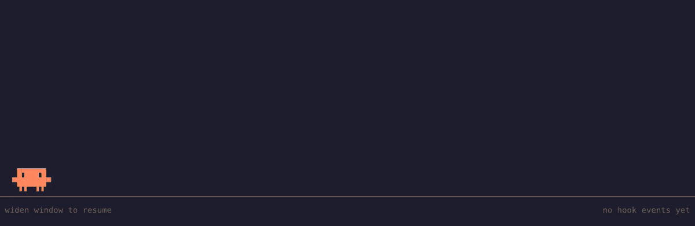

# claude-fighter

[](python/claude-fighter)
[](https://claude.com/claude-code)
[](LICENSE)

Even when your terminal is too small to be used, claude keeps you in the loop.

A wrapper for the [Claude Code](https://claude.com/claude-code) CLI. Shrink the window and the TUI is replaced by a stage: the Claude mascot shadow-boxes numbers from its own output, punches a crate every time a tool finishes, waits when it's your move, and meditates in a forest when the turn is done. Widen the window and Claude Code is back, untouched.



## Install

```sh
./install.sh              # symlinks ~/.local/bin/claude-fighter
```

Python 3.8+, no dependencies. macOS and Linux (uses a PTY).

## Usage

```sh
claude-fighter                    # wraps claude; make the window narrow to activate
claude-fighter --width 60         # activate below 60 columns (default 50)
claude-fighter --demo             # scripted events, no Claude; q to quit
claude-fighter --log /tmp/cf.log  # also append every hook event to a file (off by default)
claude-fighter -- <command>       # wrap something other than claude
```

## How it works

Claude Code runs inside a pseudo-terminal, so its output and your keystrokes pass straight through. State comes from [Claude Code hooks](hooks/) (`PreToolUse`, `PostToolUse`, `Notification`, `Stop`, …), which the wrapper loads for the session via `--settings`. Art lives in [`sprites/sprites.json`](sprites/); the renderer is a single stdlib Python script in [`python/`](python/).
